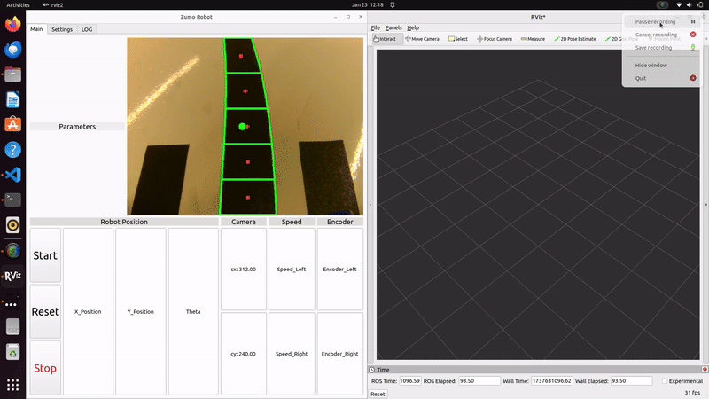
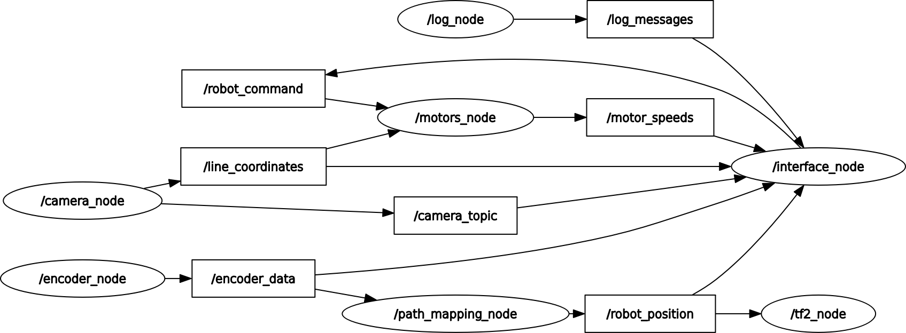

# ZumoRobot-ROS2

A Zumo robot that follows a black line with a USB webcam and draws a map of the path it has driven. Everything on the PC side runs on ROS 2 (Python, ament_python).



The camera node finds the line with OpenCV, a PID controller turns the line position into motor speeds, and the wheel encoders give the position for the map (dead reckoning).

Team project in the master's course *Autonomous Intelligent Systems* at Frankfurt UAS (winter semester 2024/25). The project is finished. The encoder library on the Arduino side is in a separate repository: [Zumo328P-Library](https://github.com/valnity98/Zumo328P-Library).

## Features

| Feature | Description |
|---|---|
| **Line detection** | Grayscale threshold → contour analysis across 5 image sections; Kalman-filtered centroid shown in the debug overlay |
| **PID motor control** | Discrete-time PID with anti-windup, derivative low-pass filter; configurable via ROS parameters |
| **Encoder odometry** | Dead-reckoning from quadrature encoder ticks; publishes `Pose` and `OccupancyGrid` |
| **TF2 broadcasting** | `map → base_link` transform published for RViz visualisation |
| **Qt GUI** | PyQt5 dashboard: live video, encoder values, motor speeds, pose, log |
| **Custom Arduino library** | Ported Zumo encoder library for the Arduino Leonardo (ATmega32U4) with interrupt-driven counting |

## Architecture

```
┌────────────────┐                     ┌───────────────────┐
│                │◄─ camera_topic ─────┤ camera_node       │
│                │◄─ line_coordinates ─┤                   │
│                │                     └─────────┬─────────┘
│                │                               ▼ line_coordinates
│                │                     ┌───────────────────┐
│                ├─ robot_command ────►│ motors_node       │
│                │◄─ motor_speeds ─────┤                   │
│                │                     └─────────┬─────────┘
│ interface_node │                               ▼ serial (speeds)
│    (Qt GUI)    │                     ┌───────────────────┐
│                │                     │ Arduino           │
│                │                     └─────────┬─────────┘
│                │                               ▼ serial (encoder packets)
│                │                     ┌───────────────────┐
│                │◄─ encoder_data ─────┤ encoder_node      │
│                │                     └─────────┬─────────┘
│                │                               ▼ encoder_data
│                │                     ┌───────────────────┐
│                ├─ robot_command ────►│ path_mapping_node │
│                │◄─ robot_position ───┤                   │
└────────────────┘                     └──┬──────────────┬─┘
                           robot_position │              │ path_map,
                                          ▼              ▼ visualization_marker
                                    ┌──────────┐     ┌───────┐
                                    │ tf2_node ├─TF─►│ RViz2 │
                                    └──────────┘     └───────┘
```

All nodes also publish status messages on `log_messages`, which the GUI shows in its log window.

The same structure as a ROS graph:



## Hardware Requirements

| Component | Details |
|---|---|
| Zumo Shield for Arduino v1.2 | Base platform with DC motors |
| Arduino Leonardo (ATmega32U4) | Motor control and encoder reading |
| Magnetic encoder pair | Pololu #3081, 12 CPR, 2.7–18 V (external, mounted manually) |
| USB webcam | Any Linux-compatible UVC camera |
| Linux PC | Runs ROS 2 nodes |
| Track | Black line on white background, ≥ 2 cm width |

## Software Requirements

- **ROS 2** Humble or Jazzy (Ubuntu 22.04 / 24.04)
- Python 3.10+
- Arduino IDE ≥ 2.0

## Installation

### 1. System dependencies

```bash
sudo apt update
sudo apt install python3-pip python3-opencv python3-pyqt5 python3-serial \
                 ros-$ROS_DISTRO-cv-bridge \
                 ros-$ROS_DISTRO-tf2-ros \
                 ros-$ROS_DISTRO-rviz2
sudo apt remove brltty   # conflicts with /dev/ttyUSB0 on Ubuntu 22.04
```

### 2. Clone and build

```bash
mkdir -p ~/ros2_ws/src && cd ~/ros2_ws/src
git clone https://github.com/valnity98/ZumoRobot-ROS2.git
rosdep install --from-paths . --ignore-src -r -y   # optional: install the dependencies declared in package.xml
cd ~/ros2_ws
colcon build --packages-select zumo_robot
source install/setup.bash
```

### 3. Flash the Arduino firmware

1. Clone [Zumo328P-Library](https://github.com/valnity98/Zumo328P-Library) and open `Zumo328P-Library/example/ZumoRos2/ZumoRos2.ino` in the Arduino IDE.
2. Install library dependencies via Library Manager: **Zumo32U4** (used by the sketch on the ATmega32U4) and **FastGPIO**. **ZumoShield** is only needed when building for an ATmega328P.
3. Copy its `library/` folder into your Arduino `libraries/` folder.
4. Flash to the Arduino Leonardo connected to the Zumo Shield.

## Usage

### Launch everything

```bash
ros2 launch zumo_robot launch_zumo.py
```

Optional arguments:

| Argument | Default | Description |
|---|---|---|
| `serial_port` | `/dev/ttyUSB0` | Arduino serial port |
| `target_position` | `320` | Image column for line centre (pixels) |

Example with custom port:

```bash
ros2 launch zumo_robot launch_zumo.py serial_port:=/dev/ttyACM0
```

An Arduino Leonardo (ATmega32U4) shows up as `/dev/ttyACM0`, a USB-serial adapter as `/dev/ttyUSB0` (the default). Check which one your system created (e.g. with `ls /dev/ttyACM* /dev/ttyUSB*`) and set `serial_port` accordingly.

### Start the robot

The robot only drives after it has received the start command: press **Start** in the GUI, or send it from a terminal:

```bash
ros2 topic pub --once /robot_command std_msgs/msg/Int8 "{data: 1}"
```

`0` stops the robot, `2` resets the encoders and the odometry (see the `robot_command` topic below).

### Run individual nodes

```bash
ros2 run zumo_robot camera_node
ros2 run zumo_robot encoder_node --ros-args -p serial_port:=/dev/ttyUSB0
ros2 run zumo_robot motors_node  --ros-args -p target_position:=320
ros2 run zumo_robot path_mapping_node
ros2 run zumo_robot interface_node
```

### Calibration

The odometry constants at the top of `zumo_robot/zumo_robot/path_node.py` are not measured for every robot. Check `CPR` and `WHEEL_RADIUS` on yours and rebuild after changing them:

- **`CPR`** (encoder counts per wheel revolution, currently `75.81 × 12`): Pololu's 12 CPR applies when both edges of both encoder channels are counted, but the Arduino library only counts the edges of channel A. Send reset (`{data: 2}`), turn one wheel by hand exactly one revolution, send stop once (`{data: 0}`, the Arduino only reports encoder values in reply to motor packets) and read the tick count with `ros2 topic echo /encoder_data`. That count is the value for `CPR`.
- **`WHEEL_RADIUS`** (currently `0.019` m): with `CPR` calibrated, reset, drive a straight 1 m and compare the distance reported in `robot_position` (metres from the start) with 1 m. Adjust `WHEEL_RADIUS` until they match.

## ROS 2 Interface

### Topics

| Topic | Type | Direction | Description |
|---|---|---|---|
| `line_coordinates` | `Float32MultiArray` | camera → motors | Centroid `[cx, cy]` (pixels) |
| `camera_topic` | `sensor_msgs/Image` | camera → GUI | Annotated BGR frame |
| `encoder_data` | `Int32MultiArray` | encoder → path/GUI | `[left_ticks, right_ticks]` |
| `motor_speeds` | `Int16MultiArray` | motors → GUI | `[left_speed, right_speed]` |
| `robot_position` | `geometry_msgs/Pose` | path → tf2/GUI | Dead-reckoning pose |
| `path_map` | `nav_msgs/OccupancyGrid` | path → RViz | Visited-cell map |
| `visualization_marker` | `visualization_msgs/Marker` | path → RViz | Path LINE_STRIP |
| `robot_command` | `Int8` | GUI → motors, path | 0=stop, 1=start, 2=reset (Arduino encoders and odometry) |
| `log_messages` | `std_msgs/String` | all → GUI | Status log |

### Parameters (motors_node)

| Parameter | Type | Default | Description |
|---|---|---|---|
| `serial_port` | string | `/dev/ttyUSB0` | Arduino port |
| `target_position` | int | `320` | Line-centre column |
| `kp` | float | `0.35` | PID proportional gain |
| `ki` | float | `0.10` | PID integral gain |
| `kd` | float | `0.10` | PID derivative gain |
| `max_speed` | float | `125.0` | Base motor speed |

`motors_node` always opens the serial port at 115200 baud (not configurable).

### Parameters (encoder_node)

| Parameter | Type | Default | Description |
|---|---|---|---|
| `serial_port` | string | `/dev/ttyUSB0` | Arduino port |
| `baudrate` | int | `115200` | Serial baud rate (must match the sketch, which uses 115200) |

## Serial Protocol (PC ↔ Arduino)

**PC → Arduino (7 bytes):**
```
0x02 | left_speed[0] | left_speed[1] | right_speed[0] | right_speed[1] | ctrl | 0x03
```
`ctrl`: `0x11` = normal run (request encoder reply), `0x12` = reset encoders.

**Arduino → PC (10 bytes):**
```
0x02 | right_enc[0..3] | left_enc[0..3] | 0x03
```
All multi-byte values are little-endian signed integers.

## Known limitations

- **No command timeout.** The robot only stops on an explicit stop command. If the camera finds no line, or the PC side stops (node crash, USB cable pulled), no new command arrives and the Arduino keeps driving at the last commanded speed. Use the **Stop** button (`robot_command` `0`) or cut the power.
- **Reverse driving is not verified.** On the ATmega32U4 the sketch drives the motors through `Zumo32U4Motors`, whose direction pins differ from those of the Zumo Shield v1.2 (see the [Zumo328P-Library](https://github.com/valnity98/Zumo328P-Library)). With the default gains the controller practically never commands negative speeds, so this path is not exercised.
- **Odometry constants are nominal.** `CPR` and `WHEEL_RADIUS` have not been calibrated on the robot (see [Calibration](#calibration)), so distances in the map are approximate.
- **Encoder data follows the motor commands.** The Arduino only replies with encoder values to motor packets, so the odometry rate follows the camera and pauses while no line is detected.
- **The serial protocol has no checksum.** Frames are recognised by their fixed length and the `0x02`/`0x03` markers only.

## Team

| Name | Role |
|---|---|
| Mutasem Bader | ROS 2 nodes, PID control, path mapping, Qt GUI, system integration |
| Felix Fritz Biermann | Image processing (camera node) |

## License

Copyright (c) 2026 Mutasem Bader. All rights reserved.  
Viewing is permitted. Copying, modifying, or submitting as own work is strictly prohibited.  
See [LICENSE](LICENSE) for details.
